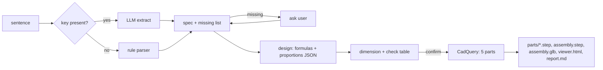

# Knuckle Joint MVP - Plan

## Goal Capsule

- **Objective:** a sentence like "knuckle joint for 50 kN" becomes 5 separate part files, one assembly file and a browser view, with every dimension traceable to a design-book rule.
- **Product authority:** Atishay (group lead for the SGSITS sem-7 major project). Guide sign-off comes after the MVP, by his choice.
- **Open blockers:** none for the build. Proportions and default stresses are unverified until checked against the department's design book.

---

## Summary

A Python command-line tool. It reads the sentence, asks for whatever spec is missing, sizes the joint from the load with textbook formulas, shows the dimensions, then builds the 5 knuckle-joint parts as exact solids and exports them. Runs free on Mac and Windows, no GPU, no paid CAD.

## Problem Frame

The major project is "Strategic application of AI in CAD": type a joint name and a spec, get a CAD model you can open in NX or any standard CAD tool. The group has no paid CAD licences outside the college lab and some laptops are weak, so everything has to be free and light. Building before showing the guide is deliberate: the working demo is the pitch.

## Requirements

- **R1.** Accept a free-text request (English or Hinglish) naming the joint and optionally the load, rod diameter and design stresses.
- **R2.** Ask only for missing specs; skip questions when the sentence already carries them.
- **R3.** Size the joint: rod diameter from tension, pin diameter from double shear, the rest from proportion rules off the pin diameter.
- **R4.** Show the dimension table and strength checks before building; build on confirmation.
- **R5.** Produce 5 separate parts: single-eye rod, fork (double-eye rod), knuckle pin, collar, taper pin.
- **R6.** Export each part as its own STEP file, one assembly STEP with parts kept separate (not fused), one GLB, and a self-contained HTML viewer.
- **R7.** Proportions and default stresses live in one editable data file, each marked with its source and an unverified flag until checked against the book.
- **R8.** Work without any API key; use an LLM for parsing only when a key is present.
- **R9.** Run on macOS (arm64) and Windows with free tools only.

### Success Criteria

- The same sentence always yields the same dimensions.
- The assembly STEP re-imports as 5 distinct solids.
- No two parts overlap (interference volume effectively zero).
- Every stress check passes for a design the tool sized itself.

## Scope Boundaries

- Only the knuckle joint in this MVP. Other joints get a clear "not built yet" message.
- No FEA, no 2D drawings, no NX plugin.
- Pin bending check not included (book includes it; deferred).

### Deferred to Follow-Up Work

- Cotter, sleeve-and-cotter, gib-and-cotter, nut-bolt generators on the same registry.
- Paper eval harness (accuracy vs handbook, paraphrase robustness).
- Offline copy of the viewer script for a no-internet lab.

---

## Key Technical Decisions

- **KTD1. LLM extracts parameters; deterministic code builds geometry.** (session-settled: user-directed, chosen over LLM-writes-script and NX plugin: repeatable output and every dimension defensible.)
- **KTD2. CadQuery for geometry, STEP as the exchange format.** STEP opens in NX, FreeCAD, Onshape, Fusion without plugins. Verified in CadQuery docs 18 Sep: assembly export supports STEP (default vs fused modes), GLTF/GLB, STL.
- **KTD3. Rule-based parser is the default; LLM is an optional upgrade.** No keys exist on this Mac; the demo must work offline and free.
- **KTD4. All parts are modelled in their assembled position.** Pin axis along Z, rod axis along X, origin at the pin centre. The assembly needs no mating step, and the separate part files still carry correct placement.
- **KTD5. Design data in JSON, not code.** The proportion table is the viva material; it must be readable and editable by teammates who do not code.
- **KTD6. Python 3.12 via uv.** System Python is 3.14; CadQuery docs warn bleeding-edge Python may lack wheels.

## High-Level Technical Design



## Output Structure

```
ai-cad/
  aicad/
    __init__.py
    __main__.py          CLI entry
    parse.py             rule parser + optional LLM
    design.py            sizing + checks
    data/knuckle.json    proportions, stresses, preferred sizes, sources
    joints/knuckle.py    geometry for 5 parts
    export.py            STEP/GLB/viewer/report
  tests/
    test_parse.py
    test_design.py
    test_geometry.py
  README.md
  pyproject.toml
```

---

## Implementation Units

### U1. Design data and sizing

**Goal:** turn load/diameter/stresses into every dimension plus strength checks.
**Requirements:** R3, R7.
**Dependencies:** none.
**Files:** `aicad/data/knuckle.json`, `aicad/design.py`, `tests/test_design.py`.
**Approach:**
1. Rod diameter from tension; pin diameter from double shear; pin diameter taken as the larger of the two, rounded up to the next preferred size.
2. Other dimensions as multiples of pin diameter from the JSON.
3. Checks: eye tension, eye shear, eye crushing, fork tension, fork shear, fork crushing, rod tension.
**Test scenarios:**
- 50 kN with 75/60/150 MPa gives rod 29.13 mm before rounding and 30 mm after; pin 30 mm; eye outer 60 mm.
- Diameter-only input (30 mm, no load) gives the same proportions and marks checks as skipped.
- Every check passes for a tool-sized design.
- Zero or negative load raises a clear error.

### U2. Parser

**Goal:** sentence to spec plus a list of missing fields.
**Requirements:** R1, R2, R8.
**Dependencies:** U1 (field names).
**Files:** `aicad/parse.py`, `tests/test_parse.py`.
**Approach:** joint keyword match; load with units N, kN, tonne; diameter in mm; optional stresses in MPa. LLM path only when `GEMINI_API_KEY` is set, validated through the same spec shape, falling back to rules on any failure.
**Test scenarios:**
- "knuckle joint for 50 kN" gives load 50000 N, nothing missing.
- "load 5000 N ka knuckle joint bana do" parses in Hinglish.
- "knuckle joint with 30 mm rod" gives diameter 30, no load.
- "knuckle joint" alone reports load/diameter missing.
- "cotter joint 20 kN" identifies cotter and is rejected as not built yet.
- "2 tonne" converts to 19613 N.

### U3. Geometry

**Goal:** the 5 parts as valid solids in assembled position.
**Requirements:** R5.
**Dependencies:** U1.
**Files:** `aicad/joints/knuckle.py`, `tests/test_geometry.py`.
**Approach:** eye rod = eye disc + rod along −X, pin hole. Fork = two plates straddling the eye + base block + rod along +X, pin hole. Pin = shank + head on top plate, radial hole at collar height. Collar under bottom plate with matching radial hole. Taper pin through collar and pin, 1:50 taper, never larger than its hole.
**Test scenarios:**
- Each part is valid with positive volume.
- Pairwise overlap volume below 0.01% of the smaller part.
- Eye can rotate: fork base clears the eye's outer radius.

### U4. Export and CLI

**Goal:** the files on disk and the interactive flow.
**Requirements:** R2, R4, R6, R9.
**Dependencies:** U1 to U3.
**Files:** `aicad/export.py`, `aicad/__main__.py`, `tests/test_geometry.py`, `README.md`, `pyproject.toml`.
**Approach:** per-part STEP, assembly STEP in default mode, GLB, viewer HTML with the GLB embedded so it opens from disk, report with dimensions and checks. CLI asks for missing specs, shows the table, asks to build; a flag skips prompts for tests and demos.
**Test scenarios:**
- Assembly STEP re-imports as exactly 5 solids.
- Each part STEP re-imports as 1 valid solid.
- Non-interactive run with a full sentence writes all expected files.
**Verification:** files open in FreeCAD on Mac; assembly opens in NX 10 in the lab (manual, pending).

---

## Assumptions

- Proportions (Khurmi-style): pin d = rod D, eye outer 2d, head and collar 1.5d, eye thickness 1.25d, fork plate 0.75d, head 0.5d. From memory, unverified.
- Default stresses 75 tension / 60 shear / 150 crushing MPa, a textbook example set, unverified.
- Collar thickness 0.5d, taper-pin diameter 0.25d (min 3 mm), fork clearance max(2 mm, 0.1d), rod lengths 3 × eye outer diameter: modelling choices, not book values.

## Verification Contract

- All unit tests pass.
- One full run for 50 kN writes 5 part STEPs, assembly STEP, GLB, viewer, report.
- Manual: FreeCAD opens the assembly with 5 components.

## Definition of Done

U1 to U4 built, tests green, a sample output folder exists, README has Mac and Windows setup, MAJOR-PROJECT.md points here.
